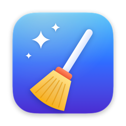
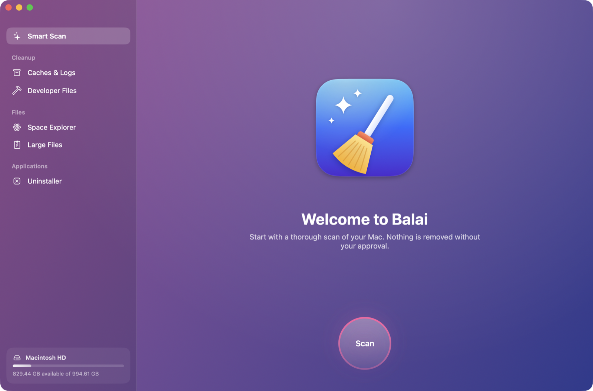
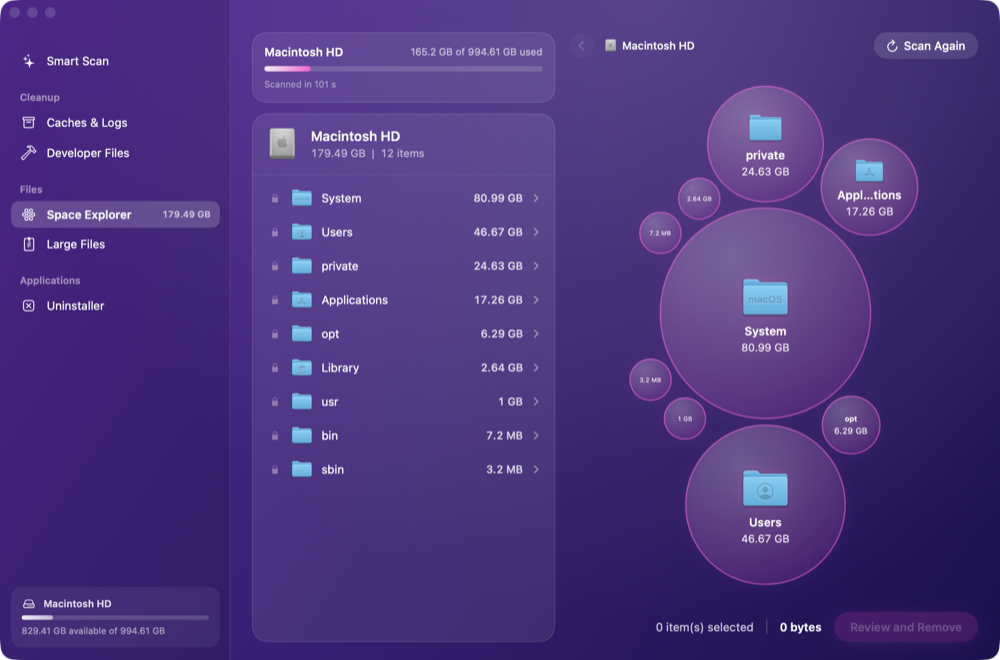
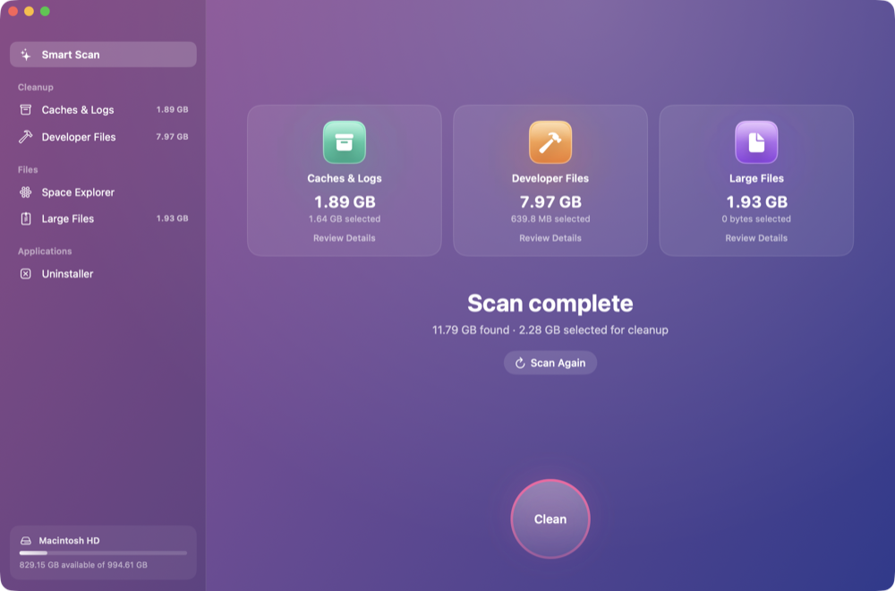
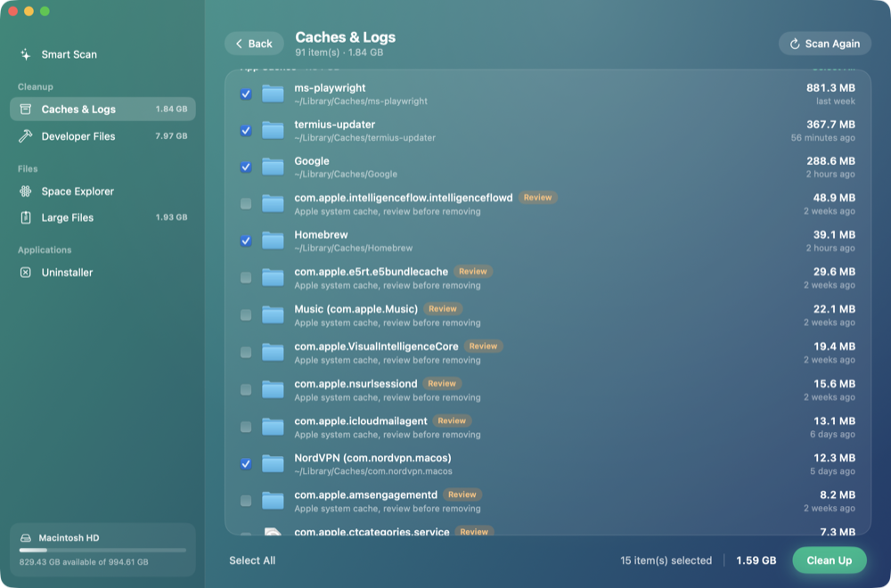
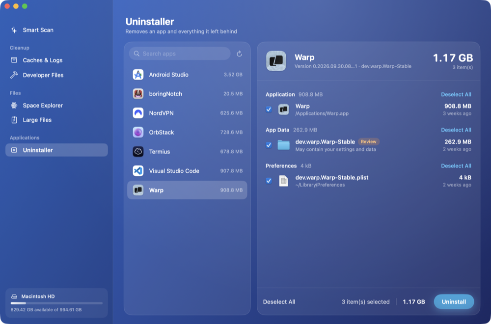

<div align="center">



# Balai

### Le nettoyeur pour Mac, libre et gratuit.
**Aussi soigné que les apps payantes, sans abonnement, sans télémétrie et sans alertes alarmistes.**

<p>
  <a href="https://github.com/root-lr/Balai/releases/latest"></a>
  
  
  <a href="LICENSE"></a>
</p>
<p>
  <a href="https://github.com/root-lr/Balai/actions/workflows/build.yml"></a>
  <a href="https://github.com/root-lr/Balai/releases"></a>
  <a href="https://github.com/root-lr/Balai/stargazers"></a>
  <a href="CONTRIBUTING.md"></a>
  
</p>

[English](README.md) · **Français** · [Télécharger](https://github.com/root-lr/Balai/releases/latest) · [Signaler un bug](https://github.com/root-lr/Balai/issues/new/choose) · [Contribuer](CONTRIBUTING.md)

<br />



</div>

<br />

## ✨ Pourquoi Balai ?

<table>
  <tr>
    <td width="33%" valign="top">
      <h3>🧹 Libère vraiment de la place</h3>
      Caches, journaux, restes de Xcode, <code>node_modules</code> oubliés, gros fichiers, apps et tout ce qu'elles laissent derrière elles. Un clic analyse tout.
    </td>
    <td width="33%" valign="top">
      <h3>🛡️ Sûr par conception</h3>
      Rien n'est supprimé sans votre confirmation. Chaque chemin passe par un seul garde-fou, couvert par des tests. Corbeille par défaut.
    </td>
    <td width="33%" valign="top">
      <h3>🔓 Libre et gratuit</h3>
      Licence MIT. Pas de compte, pas d'accès réseau, pas de télémétrie, pas de « Votre Mac est en danger ! ». Le code se lit en un après-midi.
    </td>
  </tr>
</table>

## 🚀 Fonctionnalités

| | Module | Ce qu'il fait |
|:-:|---|---|
| ✨ | **Analyse intelligente** | Lance tous les modules de nettoyage d'un coup, montre ce qui peut partir et nettoie la sélection en un clic. |
| 🗄️ | **Caches et logs** | Caches d'applications, journaux et rapports de plantage de `~/Library`. Les caches système Apple sont marqués *À vérifier* et jamais pré-cochés. |
| 🔨 | **Fichiers développeur** | DerivedData, DeviceSupport, caches et aperçus des simulateurs Xcode ; caches npm, Yarn, Bun, pnpm, Gradle, Maven, Cargo et CocoaPods ; `node_modules` des projets inactifs depuis un moment. |
| 🫧 | **Explorateur d'espace** | **Tout votre Mac** en bulles interactives, dossier par dossier : volume système, volume de données, swap, Preboot… Descendez, repérez ce qui pèse lourd, supprimez-le. |
| 📄 | **Gros fichiers** | Les fichiers volumineux qui dorment dans votre dossier personnel, classés par type : installeurs, vidéos, archives… |
| 🧩 | **Désinstalleur** | Supprime une app **et** tout ce qu'elle a laissé dans `~/Library` : préférences, caches, conteneurs, état des fenêtres, agents de lancement… |
| 🌍 | **Français et anglais** | Suit la langue du système, ou choisissez dans les Réglages. |

<div align="center">
<table>
  <tr>
    <td></td>
    <td></td>
  </tr>
  <tr>
    <td align="center"><b>Explorateur d'espace</b> : tout le disque, en bulles</td>
    <td align="center"><b>Analyse intelligente</b> : tout en un coup d'œil</td>
  </tr>
  <tr>
    <td></td>
    <td></td>
  </tr>
  <tr>
    <td align="center"><b>Détails</b> : vous décidez, élément par élément</td>
    <td align="center"><b>Désinstalleur</b> : l'app et ses restes</td>
  </tr>
</table>
</div>

## 🛡️ La sécurité d'abord

Un nettoyeur auquel on ne peut pas faire confiance est pire que pas de nettoyeur. Balai est construit autour de ça :

- **Rien n'est supprimé sans confirmation.** Vous passez chaque élément en revue, puis vous choisissez : **Mettre à la Corbeille** (récupérable, par défaut) ou **Supprimer définitivement**.
- **Les éléments risqués sont marqués *À vérifier*** et jamais pré-cochés : caches système Apple, archives Xcode, gros fichiers, conteneurs partagés, restes trouvés par le seul nom de l'app…
- **Un seul garde-fou vérifie chaque chemin** ([`SafetyGuard.swift`](Sources/Balai/Core/SafetyGuard.swift)) juste avant la suppression, quel que soit le module qui l'a proposé :
  - seuls votre dossier personnel et les apps tierces (`.app`) de `/Applications` peuvent être supprimés ;
  - **toujours refusés :** dossiers système, apps Apple, trousseaux, `~/.ssh`, `~/.gnupg`, comptes, contacts, calendriers, données Safari, Mail, Messages, iCloud Drive et stockage cloud ;
  - les chemins sont normalisés (`..`, dossiers parents en lien symbolique) et comparés sans tenir compte de la casse, comme le fait le système de fichiers.
- **L'Explorateur d'espace montre tout, mais verrouille ce qu'il ne doit pas toucher** 🔒.
- **Pas d'accès réseau, pas de télémétrie, pas de compte, pas de processus en arrière-plan.**

> [!NOTE]
> Vous avez trouvé un moyen de faire supprimer à Balai quelque chose qu'il ne devrait pas ? Signalez-le en privé : voir [SECURITY.md](SECURITY.md).

## 📦 Installation

**Configuration :** macOS 13 Ventura ou plus récent · Apple Silicon ou Intel

### Homebrew (recommandé)

```bash
brew install --cask root-lr/balai/balai
```

Homebrew gère l'avertissement de sécurité de macOS pour vous. Mise à jour : `brew upgrade --cask balai`.

### Téléchargement manuel

<a href="https://github.com/root-lr/Balai/releases/latest/download/Balai.dmg"></a>

Ouvrez le `.dmg` et glissez **Balai** dans **Applications**.

> [!IMPORTANT]
> Balai n'est pas encore notarisé (il faut un compte développeur Apple payant) : macOS bloque donc le premier lancement. Lancez une fois :
>
> ```bash
> xattr -dr com.apple.quarantine /Applications/Balai.app
> ```
>
> Ou ouvrez **Réglages Système › Confidentialité et sécurité** et cliquez sur **Ouvrir quand même**.

> [!TIP]
> Accordez l'**Accès complet au disque** (Réglages Système › Confidentialité et sécurité › Accès complet au disque), puis relancez Balai. Sans lui, certains dossiers restent invisibles aux analyses.

## 🛠️ Compiler depuis les sources

Nécessite Xcode 15 ou plus récent.

```bash
git clone https://github.com/root-lr/Balai.git
cd Balai
swift run                   # lancer en développement
swift test                  # lancer les tests
./scripts/build-app.sh      # construire Balai.app + Balai.dmg dans ./build
./scripts/make-icon.sh      # régénérer l'icône de l'app
```

Vous pouvez aussi ouvrir `Package.swift` dans Xcode.

<details>
<summary><b>Structure du projet</b></summary>

```
Sources/Balai/
├── Core/          # modèles, SafetyGuard, Deleter, permissions, traduction
├── Modules/       # un scanner par module, le désinstalleur, l'explorateur de disque
├── ViewModels/    # état de l'app (SwiftUI, @MainActor)
└── Views/         # interface : thème, composants, une vue par écran
Tests/BalaiTests/  # tests du SafetyGuard et de la détection des restes d'apps
packaging/         # cask Homebrew
scripts/           # build, icône
```

Ajouter un module de nettoyage = écrire un type conforme à `Scanner` qui renvoie des `[CleanupItem]`. Confirmation, suppression et interface sont fournies.

</details>

## 🗺️ Feuille de route

- [x] Analyse intelligente, caches, fichiers développeur, gros fichiers, désinstalleur
- [x] Explorateur d'espace pour tout le disque
- [x] Français et anglais
- [x] Cask Homebrew
- [ ] Builds notarisés
- [ ] Restes orphelins (fichiers d'apps déjà supprimées)
- [ ] Recherche de doublons
- [ ] Nettoyage des images Docker et des simulateurs iOS
- [ ] Widget de barre des menus avec l'espace libre
- [ ] Plus de langues

Des idées ? [Proposez une fonctionnalité](https://github.com/root-lr/Balai/issues/new/choose).

## 🤝 Contribuer

Balai est **ouvert aux contributions**, de la faute de frappe au nouveau module de nettoyage. Commencez par [CONTRIBUTING.md](CONTRIBUTING.md), puis cherchez les issues marquées [`good first issue`](https://github.com/root-lr/Balai/labels/good%20first%20issue).

Vous proposez un nouvel emplacement à nettoyer ? Expliquez **pourquoi il peut être supprimé sans risque** et **s'il se régénère tout seul**. C'est la seule règle.

## ⭐ Historique des étoiles

<a href="https://star-history.com/#root-lr/Balai&Date">
  
</a>

## 📄 Licence

[MIT](LICENSE). Libre d'utiliser, modifier et partager.

<div align="center">
<br />
<sub>Fait avec SwiftUI · Si Balai vous a fait gagner quelques gigaoctets, une ⭐ aide d'autres personnes à le trouver.</sub>
</div>
